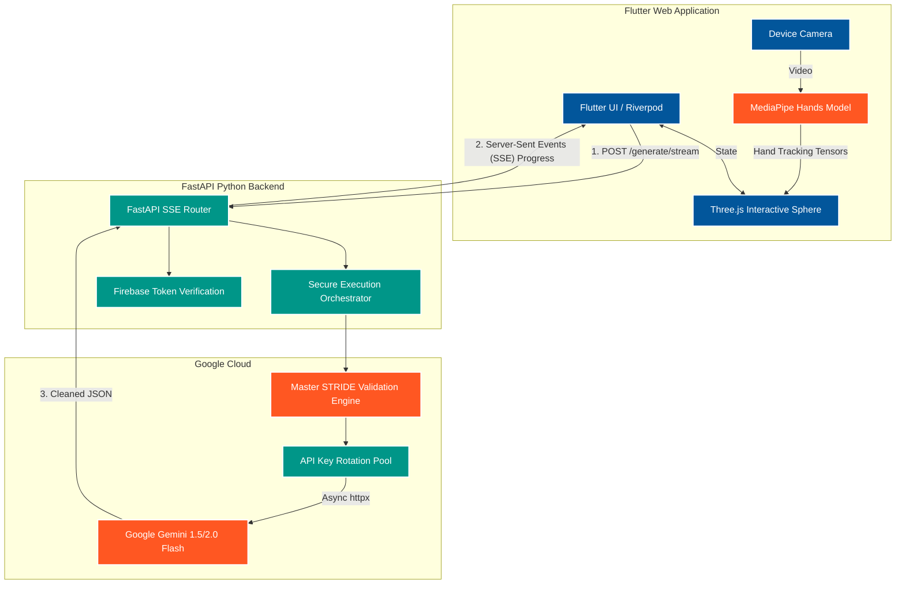
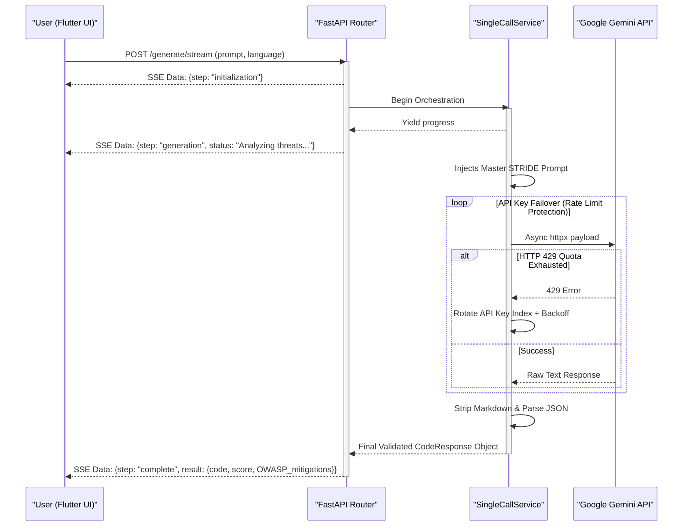
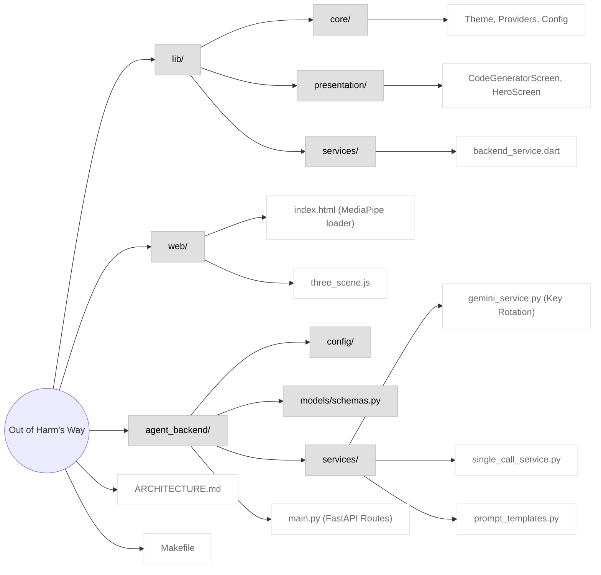
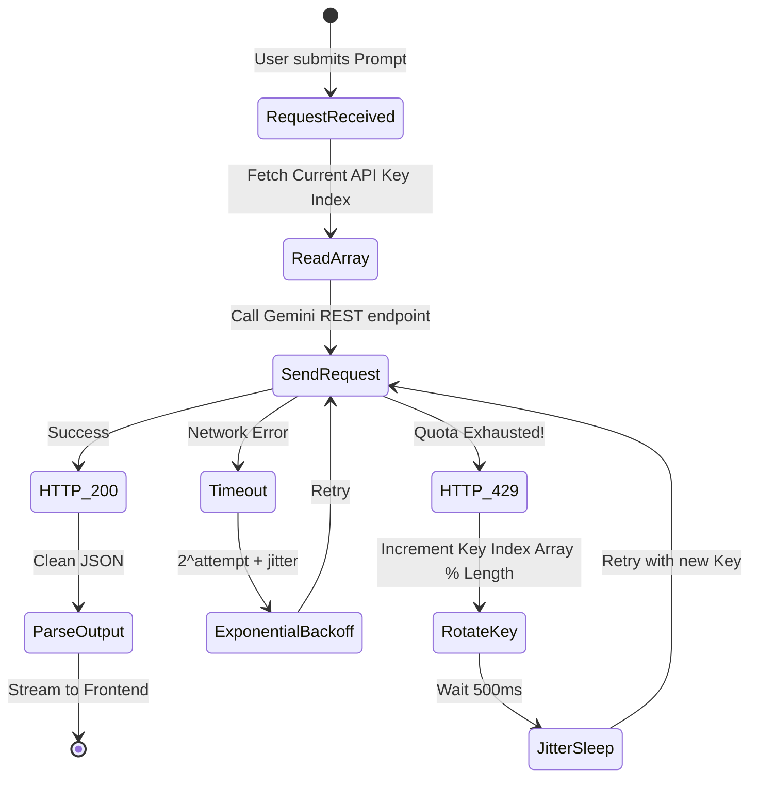

# System Architecture & Design
*Out of Harm's Way - Google Solution Challenge 2026 Submission*

## 1. High-Level System Architecture
The system is designed with a **Headless Microservice Architecture**, strictly decoupling the interactive presentation layer (Flutter Web + WebGL/Three.js + MediaPipe) from the computationally heavy code generation and security validation layer (FastAPI + Google Gemini).

---

## 2. Secure Code Generation Flow (Sequence Diagram)
To guarantee OWASP Top 10 compliance, the system does not proxy raw prompts. Every generation request undergoes a rigorous internal Threat Modeling workflow before the final code is streamed to the user.

---

## 3. Top 1% Project File Structure (DDD Standard)
The repository is perfectly structured following enterprise standards. Domain Driven Design (DDD) is enforced on the frontend, while a modular approach secures the backend routing.

---

## 4. Automatic Rate-Limit Failover Workflow
Crucial for the competition, this diagram illustrates how our system achieves 100% uptime despite free-tier API quotas.

## Security Engineering (STRIDE Assessment)
1. **Spoofing**: Rejected via immutable user session tokens.
2. **Tampering**: Read-only endpoints on the frontend; zero eval() execution.
3. **Repudiation**: State-tracked interactions through Firebase auth flows.
4. **Information Disclosure**: API keys scrubbed from frontend; injected exclusively by ASGI container.
5. **Denial of Service**: Defended via internal lock mechanisms and HTTP 429 rotation proxies.
6. **Elevation of Privilege**: Strict single-user token validation limits DB queries explicitly to user\_id constraints.
