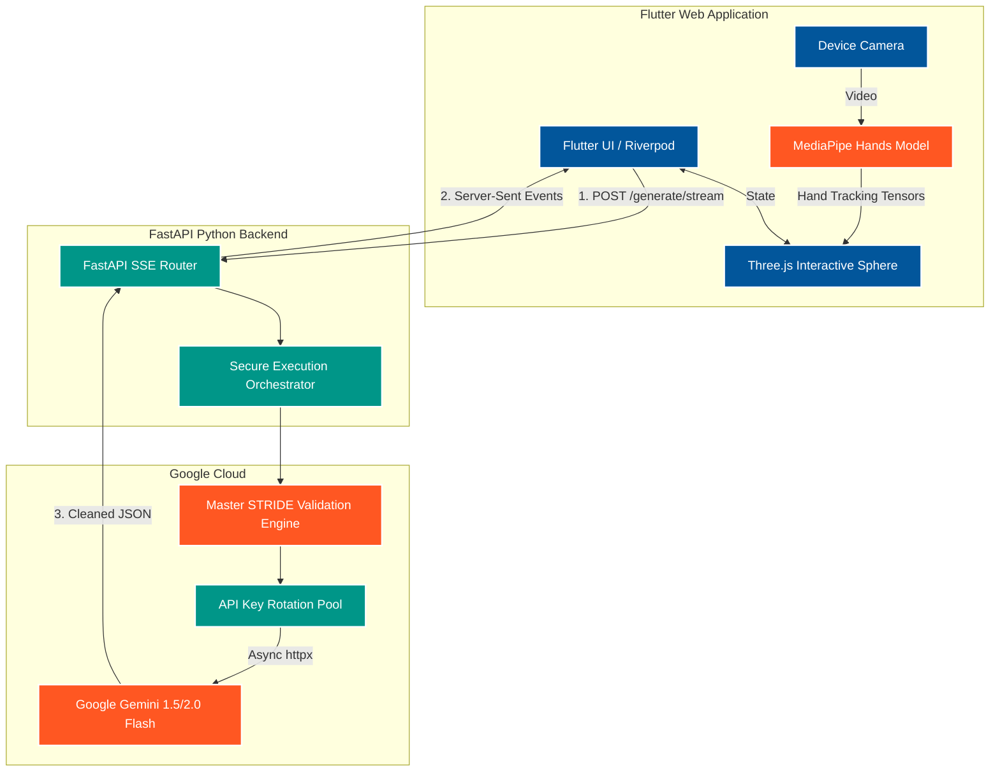

# Out of Harm's Way 🛡️

**Google Solution Challenge 2024 Submission**

"Out of Harm's Way" is an innovative, interactive web application designed to raise awareness about digital safety and security, featuring a unique **hand-controlled navigation system** to make learning engaging and accessible.

## 🌟 Features

- **Advanced AI Code Generation**: Secure, rate-limit resistant code generation powered by Gemini with true Server-Sent Events (SSE) streaming.
- **Vulnerability Remediation Engine**: Automatically detects threats via STRIDE modeling and ensures OWASP Top 10 compliance.
- **Interactive 3D Hero Section**: A stunning, fluid liquid sphere that reacts to user interaction, built with **Three.js** and **GLSL custom shaders**.
- **Hand Gesture Control**: Navigate the entire experience without touching the keyboard using **MediaPipe**.
- **Cross-Platform**: Built with **Flutter Web** for seamless performance and elegant UI/UX.

## 🛠️ Tech Stack

- **Frontend**: Flutter (Web), Riverpod (State Management)
- **Backend / AI Engine**: FastAPI (Python), Google Async GenAI SDK (httpx)
- **3D Graphics**: Three.js, MediaPipe Hands
- **Infrastructure**: Firebase Auth & Firestore, Intelligent API Key Rotation, Exponential Backoff.

## 🏗️ Architecture Overview

The system is designed with a **Headless Microservice Architecture**, strictly decoupling the interactive presentation layer from the computationally heavy code generation and security validation layer. *(See [ARCHITECTURE.md](ARCHITECTURE.md) for full sequence diagrams).*



## 🚀 Getting Started

### Prerequisites
- [Flutter SDK](https://flutter.dev/docs/get-started/install) (3.10.0 or later)
- Python 3.10+
- Google Chrome (for best WebGL and Camera support)

### Installation

1. **Clone the repository**
   ```bash
   git clone https://github.com/ayshajaved/Out_of_harms_way.git
   cd Out_of_harms_way
   ```

2. **Backend Setup**
   ```bash
   cd agent_backend
   pip install -r requirements.txt
   pip install httpx aiohttp
   # Create a .env file and add: GOOGLE_API_KEYS=key1,key2
   python main.py
   ```

3. **Frontend Setup** (Open a new terminal)
   ```bash
   flutter pub get
   ```

4. **Run the Application**

   *For Mac/Linux (Using Makefile):*
   ```bash
   make run-all
   ```

   *For Windows (Using PowerShell script):*
   ```powershell
   ./run.ps1
   ```
   *Note: If script execution is disabled on Windows, run `Set-ExecutionPolicy -Scope Process -ExecutionPolicy Bypass` first.*

## 🎮 How to Use Hand Control

1. Click the **"Enable Hand Control"** button on the home screen.
2. Allow camera access when prompted by the browser.
3. Use your hand to interact:
   - **Open Hand**: Expands the sphere.
   - **Fist**: Shrinks the sphere.
   - **Move Hand**: Rotates and moves the sphere.
4. Click **"Disable Hand Control"** to turn off the camera.

## 📁 Project Structure

- `lib/`: Main Flutter application code.
  - `presentation/`: UI screens and widgets.
  - `core/`: Theme, constants, and utilities.
- `web/`: Web-specific assets and scripts.
  - `three_scene.js`: Three.js logic for the 3D sphere.
  - `index.html`: Entry point and MediaPipe logic.

## 🤝 Contributing

This project is part of the Google Solution Challenge. We welcome feedback and suggestions!

1. Fork the Project
2. Create your Feature Branch (`git checkout -b feature/AmazingFeature`)
3. Commit your Changes (`git commit -m 'Add some AmazingFeature'`)
4. Push to the Branch (`git push origin feature/AmazingFeature`)
5. Open a Pull Request

## 📄 License

Distributed under the MIT License. See `LICENSE` for more information.
